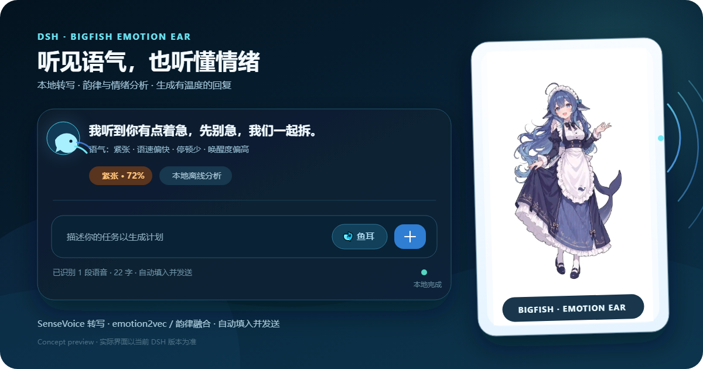
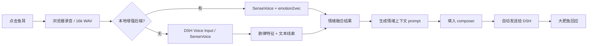

<div align="center">


# 大肥鱼 · 情绪耳朵

**让 DSH 里的大肥鱼听见你，也听懂你。**

本地语音转写 · 语气/情绪分析 · 情绪化回复 · 自动发送 · 音频不上传

[](https://deepseek1024.com/plugins/LiDu-china/dsh-dafeiyu-emotion)
[](https://www.npmjs.com/package/dsh-dafeiyu-emotion)
[](https://github.com/LiDu-china/dsh-dafeiyu-emotion/releases/latest)
[](https://github.com/LiDu-china/dsh-dafeiyu-emotion)
[](LICENSE)

[中文](#中文) · [English](#english)

</div>



> 预览为功能示意图，实际界面以当前 DSH 版本为准。
>
> 角色主视觉采用蓝发鲸鱼少女的大肥鱼设定。

🎬 [观看 43 秒功能演示](https://github.com/LiDu-china/dsh-dafeiyu-emotion/releases/download/v0.2.3/dsh-dafeiyu-emotion-demo.mp4)

---

<a id="中文"></a>

## 这是什么

这是一个给 [DeepSeek Harness](https://github.com/deepseek-ai/deepseek-harness) 使用的语音情绪插件。

它会在 DSH 输入框旁边加一个 **🐋 鱼耳** 按钮：

1. 你点一下，说一句话；
2. 插件在本机完成语音转写；
3. 同时分析语速、停顿、音高变化、能量和文字线索，得到语气/情绪；
4. 把“用户原话 + 情绪上下文”填入当前会话并自动发送；
5. DSH 里的回复模型会先承接情绪，再回答问题；桌面大肥鱼继续显示工作状态。

它不是在“读心”。它做的是 **语音转写 + 可解释的声学/文本情绪估计**，然后把这份估计作为回复风格参考。

## 两种分析模式

### 1. 轻量模式（默认，适合插件市场安装）

- 使用 DSH 自带 **Voice Input / SenseVoice** 做语音转写；
- 浏览器端计算韵律特征：语速、停顿、基频、音高波动、能量；
- 服务端融合小型中英文情绪词表，给出情绪、唤醒度、愉悦度和置信度；
- 不需要 Python、GPU 或额外模型路径。

轻量模式需要先在 **插件 → Voice Input** 中启用并准备 DSH 的本地语音模型。

### 2. 增强模式（可选，适合已有 VoiceSense 的用户）

如果你本机已经有 `语音转文本` / VoiceSense 项目，可以把 `backendRoot` 指向它：

- SenseVoice 负责转写；
- emotion2vec 负责声学情绪；
- BERT + 词典 + 韵律做融合；
- 输出更细的逐句情绪和时间线。

插件不会重新下载模型，也不会修改 VoiceSense 项目；它只是启动一个常驻 worker 复用已有环境。

## 功能

- 🎙️ 输入框内录音，不需要跳到另一个应用；
- ⌨️ DSH 原生语音快捷键，可在快捷键设置中自行改键；
- 🎛️ DSH 设置页里的完整设置卡片：启用、语言、增强后端、超时和录音上限；
- 🧭 安装 Better Sidebar 后，可把「情绪耳朵」固定到右侧边栏；
- 🎭 共情策略四档：温柔、直接、幽默、简洁；
- 📈 多段语音的情绪时间线，可悬停查看每段文本、情绪和置信度；
- 🔐 设置页内的隐私与运行状态：最近音频大小、模型加载、worker PID、临时文件清理；
- 🔌 本机 `/context` 接口，其他插件可以读取最近一次情绪上下文；
- 🔊 大肥鱼回复语音：Piper 本地模型默认朗读，Edge / 浏览器语音可选；
- 🐋 大肥鱼主题的“鱼耳”入口，和普通对话共用同一个 composer；
- 🧠 情绪标签：喜悦 / 低落 / 生气 / 紧张 / 惊讶 / 厌烦 / 平静；
- 📈 额外给出 confidence、valence、arousal 和语气摘要；
- ✍️ 自动把带情绪上下文的 prompt 填入当前会话；
- 🚀 默认自动发送，回复直接出现在对话里；
- 🔒 音频只存在内存和本机临时目录，分析后删除；
- 🧩 大肥鱼桌面角色由 `dsh-dafeiyu` 提供，本插件负责“听觉与情绪”；
- 🛠️ 如果情绪分析失败，会保留明确错误，不会假装成功。

## 安装

### 通过 1024Store

插件已收录到 [1024Store](https://deepseek1024.com/plugins/LiDu-china/dsh-dafeiyu-emotion)，可在 DSH 的 **插件市场 / Discover** 中搜索：

```text
大肥鱼情绪耳朵
dsh-dafeiyu-emotion
```

`dsh-dafeiyu-emotion` 已发布到 npm。1024Store 会自动刷新一键安装入口；如果客户端尚未缓存到新版本，可以直接使用下面的 npm 命令。

### 通过 npm

```bash
dsh plugin --profile desktop add dsh-dafeiyu-emotion
```

DSH Web 使用 `--profile web`。安装后启用 `dsh-dafeiyu-emotion`，再按提示启用 DSH 自带 **Voice Input**（轻量模式），或配置本地增强后端。

### 通过 GitHub 源安装

```bash
dsh plugin --profile desktop add github:LiDu-china/dsh-dafeiyu-emotion
```

### 通过 Release tarball

```bash
curl -L -o dsh-dafeiyu-emotion-0.3.2.tgz \
  https://github.com/LiDu-china/dsh-dafeiyu-emotion/releases/download/v0.3.2/dsh-dafeiyu-emotion-0.3.2.tgz
dsh plugin --profile desktop add "D:/path/to/dsh-dafeiyu-emotion-0.3.2.tgz"
```

> DSH Desktop 的 profile 由 Electron 应用管理；命令行安装请使用桌面应用自带的 `dsh` 命令。

## 大肥鱼语音回复

助手回复生成后，插件会通过本机事件流把文本交给 TTS，让大肥鱼把回复读出来。

默认使用 **Piper 本地模型**，音色是 `zh_CN-huayan-medium`。它不联网，延迟低，适合日常对话：

```bash
python -m pip install piper-tts
```

把模型放到默认目录：

```text
~/.dsh/dafeiyu-emotion/tts/piper/zh_CN-huayan-medium.onnx
~/.dsh/dafeiyu-emotion/tts/piper/zh_CN-huayan-medium.onnx.json
```

也可以在设置页填写自定义 Piper 模型路径。模型缺失或合成失败时，会自动回退到浏览器 `speechSynthesis`，不会让回复静默丢失。

如果更喜欢更自然的在线音色，可以把引擎切到 **Edge TTS**，默认音色 `zh-CN-XiaoyiNeural`。Edge 需要网络，且回复文本会发送到 Microsoft；如果网络或服务不可用，同样会回退到浏览器语音。

## 设置页与侧边栏

插件会把自己的设置卡片注册到 DSH 的插件设置页。打开：

```text
设置 → 插件 → 大肥鱼情绪耳朵
```

可以直接调整：

- 启用 / 停用情绪耳朵；
- 识别语言：中文、English 或自动；
- 共情策略：温柔、直接、幽默、简洁；
- VoiceSense 增强后端目录与 Python 路径；
- 单次录音上限、后端启动超时、单次分析超时。

卡片顶部会实时显示当前模式：轻量模式、增强模式已就绪、模型加载中、后端目录不存在或等待 Voice Input。保存后配置会立即写入 DSH 设置，并在路径或超时变化时自动重启语音 worker。

如果安装了 [Better Sidebar](https://github.com/omdsh-dev/DSH-better-sidebar)，还可以在右侧边栏的 `+` 菜单里固定「情绪耳朵」，把同一份设置和状态放在对话旁边。

## 语音快捷键

插件会向 DSH 注册一个原生快捷键命令。打开：

```text
设置 → 快捷键 → 搜索“大肥鱼语音”
```

即可改成你习惯的组合。默认值：

| 客户端 | 默认快捷键 |
|---|---|
| DSH Desktop（Windows / Linux / macOS） | `Alt+V` |
| DSH Web（Windows） | `Ctrl+Alt+V` |
| DSH Web（macOS） | `Cmd+Option+V` |
| DSH Web（Linux） | 默认未绑定，请在快捷键设置中指定 |

空闲时按一次开始录音；录音中再按一次会结束并分析。快捷键需要包含 `Ctrl`、`Alt`、`Shift` 或 `Cmd` 等修饰键，不能设置成裸字母键。

## 启用 Voice Input（轻量模式）

1. 打开 DSH 左侧 **插件**；
2. 找到 **Voice Input**；
3. 启用它；
4. 打开详情，下载/准备 SenseVoice 模型；
5. 回到任意普通会话，点 **🐋 鱼耳**。

如果 Voice Input 尚未准备完成，本插件会直接提示，不会静默降级或上传音频。

## 配置增强模式

在你的 DSH profile 配置覆盖层中，把 `backendRoot` 指向 VoiceSense 项目根目录：

```yaml
- id: dsh-dafeiyu-emotion
  config:
    backendRoot: D:/path/to/voice-sense
```

可配置字段：

| 字段 | 默认 | 说明 |
|---|---|---|
| `enabled` | `true` | 是否启用插件 |
| `backendRoot` | 空 | VoiceSense 项目根目录；空则使用 DSH Voice Input 轻量模式 |
| `pythonPath` | 空 | 自定义 Python；空则自动寻找 `.venv-ser` |
| `language` | `zh` | 识别语言：`zh` / `en` / `auto` |
| `empathyStyle` | `gentle` | 共情策略：`gentle` / `direct` / `humorous` / `concise` |
| `ttsEnabled` | `true` | 是否朗读大肥鱼回复 |
| `ttsOnlyAfterVoice` | `true` | 只朗读录音后两分钟内的回复 |
| `ttsEngine` | `piper` | `piper` 本地 / `edge` 在线 / `browser` 系统语音 |
| `ttsVoice` | `zh-CN-XiaoyiNeural` | Edge TTS 音色 |
| `ttsRate` | `+6%` | Piper/Edge 语速 |
| `ttsPitch` | `+12Hz` | Edge 音调 |
| `ttsPiperModel` | 空 | 自定义 Piper 模型路径；空则用默认目录 |
| `maxAudioBytes` | 12 MB | 单次录音大小上限 |
| `startupTimeoutMs` | 180000 | 首次加载增强后端的最长等待 |
| `requestTimeoutMs` | 180000 | 单次分析请求超时 |

也可以设置环境变量：

```bash
DSH_DAFEIYU_EMOTION_BACKEND=D:/path/to/voice-sense
```

## 工作流程



音频不会进入 Session 事件或附件；只有最终文本和情绪摘要会进入对话。分析期间的 WAV 使用系统临时目录，请求结束即删除。

## 隐私与安全

- 默认全本地：转写、声学分析、情绪融合都在本机完成；
- 不读取屏幕，不监听常驻麦克风，只在点击鱼耳后录音；
- 单次录音上限 30 秒（客户端），避免意外长时间采集；
- 不对音频做云端上传；
- 不自动执行用户语音中的命令；
- 不把情绪预测当成医学或心理诊断。

## 常见问题

### 点鱼耳后一直提示“等麦克风”

检查系统麦克风权限、DSH 窗口权限，以及是否选择了可用的输入设备。关闭后重新点击即可。

### 提示“DSH 自带语音输入未启用”

去 **插件 → Voice Input** 启用并下载模型；或者配置增强后端的 `backendRoot`。

### 第一次分析很慢

增强模式首次启动需要加载 SenseVoice、BERT 文本模型和 emotion2vec，通常十几到几十秒；之后 worker 常驻，热请求通常在一秒内。

### 情绪判断不准怎么办

1. 靠近麦克风、减少环境噪声；
2. 一次只说一两句；
3. 尽量用完整自然句，不要只给单个词；
4. 在增强模式中使用你所在语言/说话人更匹配的模型；
5. 把它当“回复风格参考”，不要当读心或诊断。

### 插件会不会让大肥鱼乱回答？

不会。插件只增加一段带边界的情绪上下文，并要求模型“自然承接、不要复述分析、不要声称读心”。正常的任务指令、代码修改、工具调用仍由 DSH 正常处理。

## 开发

```bash
git clone https://github.com/LiDu-china/dsh-dafeiyu-emotion.git
cd dsh-dafeiyu-emotion
npm run check
npm pack
```

### 目录

```text
dsh-dafeiyu-emotion/
├─ src/index.js              Host：HTTP 端点、DSH Voice Input 调用、增强后端
├─ lib/client.js             浏览器：录音、WAV、韵律特征、情绪 UI、自动发送
├─ backend/voice_worker.py   可选 VoiceSense 常驻 worker
├─ cordis.patch.yml          bundle 挂载：大肥鱼 + 情绪耳朵
├─ assets/icon-512.png       插件图标
├─ assets/bigfish-*.png      角色主视觉素材
├─ docs/preview.svg          可编辑预览源
└─ package.json
```

### 贡献

欢迎提交 issue / PR。请优先附上：

- DSH 版本；
- 操作系统；
- 使用的是轻量模式还是增强模式；
- 错误提示（请移除任何密钥、账号、个人音频路径）。

## 许可与致谢

- 本仓库代码：MIT；
- 桌面角色与基础 companion 能力来自 [dsh-dafeiyu](https://github.com/QCYTSN/dsh-dafeiyu)，按其自身许可使用；
- 语音识别：[SenseVoice](https://github.com/FunAudioLLM/SenseVoice)；
- 声学情绪模型：[emotion2vec](https://github.com/ddlBoJack/emotion2vec)；
- 宿主：[DeepSeek Harness](https://github.com/deepseek-ai/deepseek-harness)。

本项目不是 DeepSeek 官方项目；第三方名称、模型和角色权利归各自权利人所有。

如果它让你的 DSH 更有温度，欢迎给仓库点一个 ⭐。

---

<a id="english"></a>

## English

**BigFish Emotion Ear** is a DSH companion plugin that listens to the user, transcribes speech locally, estimates vocal emotion and speaking style, and adds a compact emotion-aware context to the current DSH conversation before the model replies.

### Highlights

- One-click microphone activity inside the DSH composer;
- A native DSH voice shortcut you can rebind in Settings → Shortcuts;
- Local transcription via DSH Voice Input/SenseVoice;
- Lightweight prosody + keyword emotion estimation with no Python requirement;
- Optional high-accuracy VoiceSense backend with SenseVoice + emotion2vec;
- Auto-send with a short emotion-aware prompt;
- Audio stays local and is deleted after analysis.

### Install

```bash
dsh plugin --profile desktop add dsh-dafeiyu-emotion
```

The package is live on [npm](https://www.npmjs.com/package/dsh-dafeiyu-emotion) and listed in [1024Store](https://deepseek1024.com/plugins/LiDu-china/dsh-dafeiyu-emotion). The store's one-click entry refreshes automatically. A GitHub-source install and a tarball on [GitHub Releases](https://github.com/LiDu-china/dsh-dafeiyu-emotion/releases/latest) are also available.

Then enable **Voice Input** in DSH Plugins and prepare its local model. For the enhanced mode, set `backendRoot` to a voice-sense checkout with `.venv-ser`.

The shortcut command is listed as **BigFish voice: start / stop**. Desktop defaults to `Alt+V`; Web defaults to `Ctrl+Alt+V` on Windows, `Cmd+Option+V` on macOS, and is unbound on Linux Web until you choose a binding.

### Limitations

Emotion estimation is probabilistic and context-dependent. It is a communication aid, not mind reading and not a medical or psychological diagnostic tool.

## License

MIT. See [LICENSE](LICENSE).
